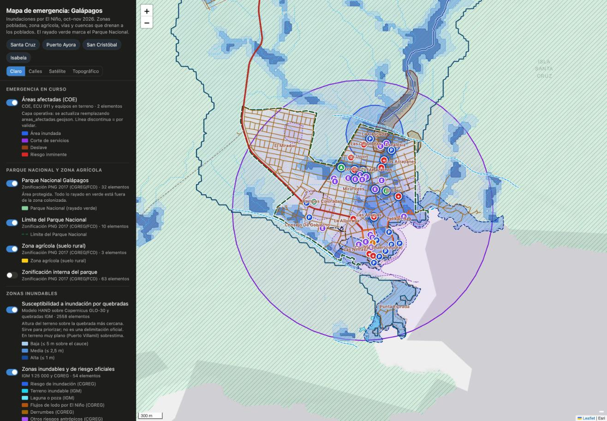

# SOS Galápagos — Gestión de Emergencias · Sociedad Civil Galápagos

**Plataforma para coordinar la ayuda durante las inundaciones por El Niño en Galápagos (2026).** Reúne en un solo lugar las necesidades de la población, los albergues y centros de acopio, el voluntariado y la logística. Trabaja junto a organizaciones de la sociedad civil y en coordinación con el COE.

🌐 **https://sosgalapagos.org**

> Este repositorio es un **fork** de [**ResponseGrid**](https://github.com/GlobalEmergency/ResponseGrid), la plataforma de software libre de coordinación de ayuda en emergencias de **[Global Emergency](https://globalemergency.online)**. La adaptación para Galápagos la impulsa la **Universidad San Francisco de Quito (USFQ Galápagos)** y la desarrolla **[IA Humana](https://iahumana.org)**. El README original de ResponseGrid está en [`README-ResponseGrid.md`](README-ResponseGrid.md).



---

## Para qué sirve

| Si eres… | Puedes… |
|---|---|
| **Persona afectada** | Registrar tu necesidad y encontrar el enlace al formulario oficial del COE para damnificados. |
| **Voluntario o voluntaria** | Apuntarte con tus capacidades (camioneta, sanitario o médico, logística, cocina, idiomas, administración, apoyo general, ONG u organismo estatal), tomar tareas y unirte a los grupos de coordinación por WhatsApp. |
| **Organización o coordinación** | Validar necesidades y puntos, crear tareas, seguir expediciones entre islas y ver todo en el mapa. |
| **Cualquier persona** | Ver qué se necesita hoy, dónde están los albergues y el centro de acopio, el estado del agua y del clima, y a qué organizaciones con trazabilidad donar dinero. |

**Reglas de la respuesta**, que la plataforma comunica en todas sus páginas:
- No enviar donaciones físicas desde el continente: ponen en riesgo la bioseguridad y saturan la logística.
- Donar dinero a organizaciones con trazabilidad, nunca a cuentas personales. Comprar en Santa Cruz para sostener la economía local.
- No enviar material sin destino o punto receptor asignado, ni alimentos caseros, mal empacados o a punto de caducar.
- No acudir por cuenta propia a las zonas afectadas.

---

## Qué cambia respecto a ResponseGrid

El núcleo, que es la arquitectura, el dominio y la API, es el de ResponseGrid. Sobre él, este fork añade:

| Cambio | Dónde |
|---|---|
| **Portada** «Gestión de Emergencias — Sociedad Civil Galápagos». Lee en vivo las necesidades validadas y muestra albergues, agua, clima, organizaciones y grupos de WhatsApp. | `apps/web/src/app/page.tsx`, contenido en `apps/web/src/lib/portada-galapagos.ts` |
| **Mapa con capas cartográficas** de Galápagos: susceptibilidad a inundación, zonas inundables oficiales, quebradas y cuencas que drenan a los poblados, Parque Nacional y zona agrícola, barrios, vías, relieve y puntos clave. Se definen con un manifiesto por emergencia. | `apps/web/public/capas/galapagos-2026/`, `apps/web/src/lib/map-layers/`, [`docs/capas-emergencia.md`](docs/capas-emergencia.md) |
| **Proceso reproducible de geodatos** (OSM, IGM, CGREG, SNGR, INEC y Copernicus) con documentación de metodología, fuentes y licencias | [`geodatos/`](geodatos/) |
| **Co-branding** USFQ Galápagos × ResponseGrid: sistema WE WANT MORE, con rojo, negro y blanco y Zalando Sans Expanded | `apps/web/src/app/globals.css`, `apps/web/src/lib/marca.ts`, `apps/web/public/marca/` |
| **Ecuador:** teléfonos en formato 09…, consentimiento según la Ley Orgánica de Protección de Datos Personales y formulario de voluntariado sin «municipio» | formularios en `apps/web/src/app/` |
| **Capacidades nuevas de voluntariado:** `ngo` (ONG) y `government` (organismo estatal) | `apps/api/src/contexts/volunteers/domain/volunteer-enums.ts` |
| **Grupos de WhatsApp con código QR** | `apps/web/src/lib/grupos-whatsapp.ts` |
| **Rate limit por persona detrás de Cloudflare:** la web reenvía a la API la IP real con un secreto compartido, para que el límite no sea global | `apps/api/src/shared/http/client-ip.ts`, `apps/web/src/lib/forwarded-ip.ts` |
| Bots de chat de la emergencia de Venezuela desactivados | `NEXT_PUBLIC_AID_BOTS_ENABLED=false` |
| **Despliegue en un servidor** con Docker Compose y Caddy detrás de Cloudflare | [`deploy/sosgalapagos/`](deploy/sosgalapagos/) |
| **Datos iniciales** de la emergencia, por API e idempotentes | [`galapagos/seed-galapagos.mjs`](galapagos/seed-galapagos.mjs) |

---

## Estructura

```
├─ apps/
│  ├─ api/                 NestJS 11 · hexagonal/DDD · Drizzle · Postgres + Redis   (ResponseGrid)
│  └─ web/                 Next.js 16 · React 19 · Tailwind · Leaflet               (ResponseGrid + adaptación)
├─ packages/               Cliente tipado de la API y dominio de almacén            (ResponseGrid)
├─ deploy/sosgalapagos/    Producción: docker-compose, Caddyfile, firewall, backups
├─ galapagos/              Datos iniciales y arranque local de esta instancia
├─ geodatos/               Proceso de capas cartográficas (scripts y documentación)
└─ docs/                   Documentación de ResponseGrid y de este fork
```

---

## Desarrollo local

Requisitos: Node 22+, pnpm 10.33.4 (vía corepack), Postgres 16+ y Redis 7.

```bash
corepack enable
pnpm install
pnpm --filter "./packages/*" build
cp apps/api/.env.example apps/api/.env          # DATABASE_URL, REDIS_URL, JWT_SECRET
cp apps/web/.env.example apps/web/.env.local    # API_URL, NEXT_PUBLIC_API_URL, DEMO_MODE=false
for f in apps/api/drizzle/*.sql; do psql "$DATABASE_URL" -v ON_ERROR_STOP=1 -f "$f"; done
pnpm --filter api start:dev                     # API en :3000 (Swagger en /docs)
pnpm --filter web build && pnpm --filter web start   # web en :3001
```

En macOS con Homebrew, `galapagos/arrancar-local.sh` hace lo mismo. Para precargar la emergencia de Galápagos con una cuenta administradora:

```bash
API_URL=http://localhost:3000 ADMIN_EMAIL=… ADMIN_PASSWORD=… node galapagos/seed-galapagos.mjs
```

El mapa de Leaflet se valida con la web en modo producción (`next start`). Con `next dev` el navegador puede congelarse.

---

## Producción

La guía está en [`deploy/sosgalapagos/README.md`](deploy/sosgalapagos/README.md). En resumen:

```
Usuarios → Cloudflare (DNS, HTTPS, WAF, caché) → Caddy :443 → web (Next) y /backend → API (NestJS)
                                                                Postgres · Redis · backups diarios
```

- El servidor solo acepta tráfico web desde Cloudflare.
- Los secretos se guardan únicamente en `deploy/sosgalapagos/.env`, en el servidor, y nunca entran en el repositorio.

---

## Privacidad

- No se publican nombres ni datos de salud de personas afectadas. Las ubicaciones de las necesidades se aproximan (±300 m).
- No se publican contactos personales de coordinación, solo instituciones.
- Las capas cartográficas excluyen los datos personales de las fuentes oficiales. Por ejemplo, los consultorios privados que el MSP registra con el nombre del profesional aparecen como «Consultorio general».
- Los datos crudos de geodatos no se suben al repositorio (ver `geodatos/.gitignore`).

¿Encontraste un problema de seguridad? Escríbenos de forma privada a través de [iahumana.org](https://iahumana.org) en lugar de abrir un issue público.

---

## Licencia y créditos

- **Código:** [GNU AGPL-3.0](LICENSE), igual que ResponseGrid. Si ejecutas una versión modificada como servicio en red, debes publicar su código.
- **ResponseGrid** © [Global Emergency](https://globalemergency.online) y su comunidad de voluntarios: es la plataforma base de este fork.
- **Adaptación para Galápagos:** Universidad San Francisco de Quito (USFQ Galápagos). Desarrollo: [IA Humana](https://iahumana.org).
- **Marca USFQ:** los logos de `apps/web/public/marca/` pertenecen a la USFQ y no están cubiertos por la AGPL. La tipografía Zalando Sans Expanded usa la licencia OFL.
- **Datos cartográficos:** © colaboradores de OpenStreetMap (ODbL), IGM, CGREG/FCD, SNGR/INOCAR, INEC, MSP, MINEDUC y Copernicus GLO-30. Las atribuciones están en [`geodatos/docs/03-fuentes-y-licencias.md`](geodatos/docs/03-fuentes-y-licencias.md).
